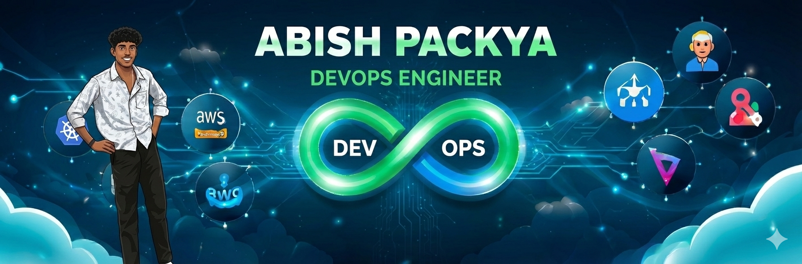

<!--

  

 -->
<h1 align="center">Hi 👋, I'm Abish Packya from India</h1>

<h3 align="center">Platform Engineer focused on Azure, DevOps automation, and microservices for scalable, efficient systems.</h3>

  

- 🔭 I'm currently working as a **Platform Engineer**, focused on Azure cloud infrastructure, DevOps practices, and microservices architecture

- 🌱 I'm currently learning **Microsoft Fabric services and Microsoft Foundry**

- 💬 Ask me about **DevOps, Microsoft Azure, Microservices, Kubernetes, Python, Linux System Administration, Git, Docker, Terraform, Jenkins, Ansible, Bash Scripting, Web Services, MySQL**

- 📫 How to reach me **abishpackya15@gmail.com**

- ⚡ Fun fact **I am talkative**

- 📄 Know about my experiences [https://iam-abish.github.io/portfolio/](https://iam-abish.github.io/portfolio/)

<h3 align="left">Connect with me:</h3>

<h3 align="left">Languages and Tools:</h3>

  <!-- OS & Shell -->
  
  

  <!-- Version Control -->
  
  

  <!-- Containerization & Orchestration -->
  
  

  <!-- CI/CD & Automation -->
  
  
  
  

  <!-- Monitoring & Observability -->
  
  

  <!-- Cloud -->
  
  

